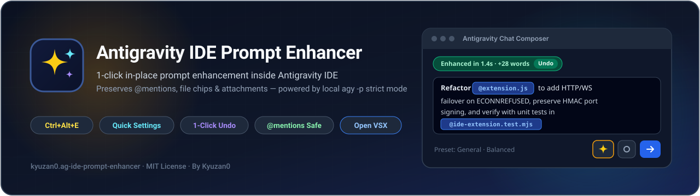
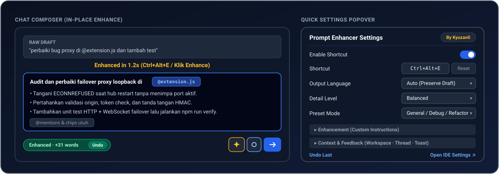
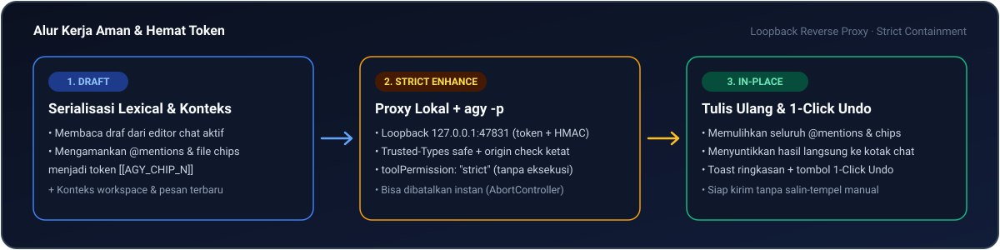

<p align="center">
  
</p>

<p align="center">
  <a href="https://open-vsx.org/extension/kyuzan0/ag-ide-prompt-enhancer"></a>
  <a href="LICENSE"></a>
  <a href="CHANGELOG.md"></a>
  <a href="https://github.com/Kyuzan0"></a>
</p>

Ekstensi VS Code-compatible (`kyuzan0.ag-ide-prompt-enhancer`, versi aktif mengikuti [`package.json`](package.json)) yang menambahkan tombol **✦ Enhance Prompt**, popover **⚙ Quick Settings**, dan shortcut yang dapat dikustomisasi (`Ctrl+Alt+E` / `Cmd+Alt+E`) langsung di sebelah tombol **Send (→)** pada sidebar chat **Antigravity IDE** (`antigravity.panel`), sambil mempertahankan `@mentions`, file chips, dan lampiran Lexical (`[[AGY_CHIP_N]]`).

## Fitur Utama

- **Tombol `✦` & Shortcut `Ctrl+Alt+E` / `Cmd+Alt+E`:** Menulis ulang draf prompt aktif secara *in-place* menggunakan model yang sedang dipilih, konteks workspace aktif, dan konteks percakapan terbaru secara hemat token.
- **1-Click Undo & Toggle-Cancel:** Tombol **Undo** beserta ringkasan durasi/jumlah kata di status toast untuk mengembalikan draf asli, serta klik ulang `✦` / shortcut / `Esc` untuk membatalkan proses *in-flight*.
- **Quick Settings (`⚙`) & Sinkronisasi IDE Settings:** Mengatur shortcut, bahasa output (`auto`, `id`, `en`), tingkat detail (`concise`, `balanced`, `comprehensive`), preset mode (`general`, `debug`, `refactor`, `architecture`), `customInstructions`, toggle konteks, status toast, serta badge versi & credit author.
- **Command Palette & Diagnostik:** Perintah **`Prompt Enhancer: About & Version Info`** (`antigravityEnhancer.about`), **`Prompt Enhancer: Show Diagnostics & Health Check`** (`antigravityEnhancer.diagnostics`), serta notifikasi pembaruan satu kali (*What's New*).
- **Preservasi Token & Lampiran:** Menjaga `@file`, `@symbol`, dan attachment chips tanpa mengekspansinya.
- **Loopback Reverse Proxy & Self-Healing:** Menjalankan HTTP + WebSocket reverse proxy lokal (`127.0.0.1:47831`, terisolasi per window via `__agy_hub`) untuk menyuntikkan [enhance-ide-hook.js](enhance-ide-hook.js) secara *Trusted-Types safe*, sekaligus otomatis memulihkan patch `workbench*.html`, `extensions/agy/vscode/extension.js`, dan checksum `product.json` setelah pembaruan IDE.
- **Strict Containment:** Memanggil biner native `agy -p` dengan `toolPermission: "strict"` dan `permissions.deny` untuk seluruh kelas tool.

## Pratinjau Antarmuka

<p align="center">
  
</p>

Tombol **`✦` Enhance** dan **`⚙` Quick Settings** menyatu langsung di sebelah tombol **Send (`→`)** dengan preservasi chip `@mentions` serta tombol **Undo** instan.

## Cara Kerja

<p align="center">
  
</p>

## Prasyarat

- **Antigravity IDE**
- **`agy` CLI** native tersedia di `PATH` atau `~/.gemini/bin/agy*` (atau atur `antigravityPromptEnhancer.cliPath` / `AGY_CLI_BIN`).
- **PowerShell** `5.1` / `7+` *(untuk `install-ide-enhancer.ps1` di Windows)*.
- **Node.js** `>= 18` *(untuk unit test, rilis SemVer, dan build `.vsix`)*.

## Instalasi & Setup

### Windows (PowerShell)

```powershell
# Opsional: dry-run terlebih dahulu
powershell -ExecutionPolicy Bypass -File install-ide-enhancer.ps1 -WhatIf

# Instal dari source (atau tambahkan -VsixPath auto untuk mengekstrak .vsix terbaru dari build/)
powershell -ExecutionPolicy Bypass -File install-ide-enhancer.ps1
```

### Linux / macOS (Bash)

```bash
# Instal dari source (atau tambahkan --vsix auto untuk mengekstrak .vsix terbaru dari build/)
./install-ide-enhancer.sh
```

Setelah instalasi, lakukan **restart penuh Antigravity IDE** (atau **`Developer: Reload Window`**) agar patch `workbench*.html` dan checksum `product.json` aktif.

## Build `.vsix` & Alur Rilis (SemVer + Changelog)

Ekstensi ini menggunakan [`package.json`](package.json) sebagai *single source of truth* versi (SemVer `MAJOR.MINOR.PATCH`) dan [`CHANGELOG.md`](CHANGELOG.md) berformat **Keep a Changelog**.

```bash
# 1. Jalankan syntax check, unit test, dan verifikasi kontrak
npm run verify

# 2. Build paket .vsix bersih ke folder build/ (otomatis menghapus .vsix versi lama)
npm run package

# 3. Atau jalankan alur rilis lengkap (bump versi + update CHANGELOG.md + verify + build .vsix):
npm run release:patch   # 1.2.0 -> 1.2.1
npm run release:minor   # 1.2.0 -> 1.3.0
npm run release:major   # 1.2.0 -> 2.0.0
```

Opsi tambahan pada [`scripts/release.mjs`](scripts/release.mjs):
- `--dry-run`: pratinjau perubahan versi dan `CHANGELOG.md` tanpa menulis file.
- `--from-git`: isi entri changelog otomatis dari riwayat `git log`.
- `--tag`: buat tag Git `vX.Y.Z` otomatis jika working tree sudah bersih.

### Publikasi Otomatis (Open VSX Trusted Publishing & GitHub Releases)

Push tag `v*` akan memicu [`.github/workflows/release.yml`](.github/workflows/release.yml) untuk memverifikasi, membangun `build/ag-ide-prompt-enhancer-<version>.vsix`, membuat GitHub Release, dan mem-publish ke **Open VSX** tanpa PAT melalui **OIDC Trusted Publishing**:
- **Provider:** `GitHub Actions`
- **Repository:** `Kyuzan0/Enhance-Prompt-Antigravity`
- **Workflow:** `release.yml`
- **Extension:** `kyuzan0.ag-ide-prompt-enhancer`

*(Catatan: Rilis perdana ke Open VSX harus di-publish sekali terlebih dahulu dengan PAT sebelum OIDC Trusted Publishing aktif. Untuk Visual Studio Marketplace, tambahkan secret `VSCE_PAT` opsional di repository GitHub.)*

## Konfigurasi & Environment Variables

| Variable / Setting | Default | Deskripsi |
|---|---|---|
| `antigravityPromptEnhancer.shortcutEnabled` | `true` | Aktifkan trigger keyboard shortcut di kotak input chat. |
| `antigravityPromptEnhancer.shortcut` | `Ctrl+Alt+E` | Shortcut kustom (`Ctrl+Alt+E` / `Cmd+Alt+E` di macOS). |
| `antigravityPromptEnhancer.outputLanguage` | `auto` | Bahasa output (`auto`, `id`, `en`). |
| `antigravityPromptEnhancer.detailLevel` | `balanced` | Tingkat detail (`concise`, `balanced`, `comprehensive`). |
| `antigravityPromptEnhancer.preset` | `general` | Mode preset enhancement (`general`, `debug`, `refactor`, `architecture`). |
| `antigravityPromptEnhancer.customInstructions` | `""` | Instruksi tambahan singkat (maks. 400 karakter). |
| `antigravityPromptEnhancer.includeWorkspaceContext` | `true` | Sertakan struktur workspace, manifest, dan tab editor aktif. |
| `antigravityPromptEnhancer.includeConversationContext` | `true` | Sertakan pesan terbaru dari thread chat aktif. |
| `antigravityPromptEnhancer.showToast` | `true` | Tampilkan toast status di panel chat. |
| `AGY_ENHANCER_PORT` / `antigravityPromptEnhancer.proxyPort` | `47831` | Port loopback preferensi untuk proxy lokal (fallback ke port ephemeral jika sibuk). |
| `AGY_CLI_BIN` / `antigravityPromptEnhancer.cliPath` | Auto (`~/.gemini/bin/agy*`) | Override path ke biner native `agy`. |
| `AGY_ENHANCER_TIMEOUT_MS` / `antigravityPromptEnhancer.timeoutMs` | `60000` | Timeout (ms) eksekusi `agy -p`. |
| `ANTIGRAVITY_EXTENSIONS_DIR` | `%USERPROFILE%\.antigravity-ide\extensions` | Target direktori ekstensi untuk `install-ide-enhancer.ps1`. |
| `ANTIGRAVITY_IDE_APP_ROOT` | Auto-detected | Path `resources/app` Antigravity IDE untuk `install-ide-enhancer.ps1`. |

## Verifikasi

```bash
node --check extension.js
node --check enhance-ide-hook.js
node --test ide-extension.test.mjs
node verify-contracts.mjs
```

Lihat prosedur acceptance live di [docs/RUNBOOK_IDE_ACCEPTANCE.md](docs/RUNBOOK_IDE_ACCEPTANCE.md).

## Uninstall & Rollback

```powershell
powershell -ExecutionPolicy Bypass -File install-ide-enhancer.ps1 -Uninstall
```

Atau di Linux / macOS:

```bash
./install-ide-enhancer.sh --uninstall
```

Perintah di atas memulihkan `workbench.html`, `workbench-jetski-agent.html`, dan `extensions/agy/vscode/extension.js` dari `.enhancer.bak`, menyinkronkan ulang checksum `product.json`, menghapus file hook yang disuntikkan, serta menghapus registrasi ekstensi.

## Author, Credits & Changelog

- **Author & Maintainer:** [**Kyuzan0**](https://github.com/Kyuzan0)
- **Repository:** [Kyuzan0/Enhance-Prompt-Antigravity](https://github.com/Kyuzan0/Enhance-Prompt-Antigravity)
- **Riwayat Rilis:** Lihat [CHANGELOG.md](CHANGELOG.md)
- **Lisensi:** Dilisensikan di bawah [MIT License](LICENSE)
